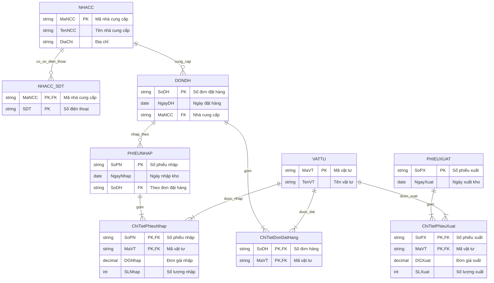

# [Thực hành] Chuyển đổi ERD sang mô hình quan hệ (Relational Model)

## 🎯 Mục tiêu
- Nắm vững các nguyên tắc và kỹ thuật chuyển đổi từ mô hình thực thể liên kết (**ERD - Entity Relationship Diagram**) sang **mô hình dữ liệu quan hệ (Relational Schema)**.
- Phân biệt và xử lý chính xác các mối quan hệ: một - một (`1 - 1`), một - nhiều (`1 - n`), và nhiều - nhiều (`n - m`).
- Nắm vững phương pháp chuẩn hóa xử lý **thuộc tính đa trị (Multi-valued Attributes)** thành một quan hệ độc lập để đạt dạng chuẩn 1NF.
- Xác định rõ ràng các khóa chính đơn, khóa chính phức hợp và các khóa ngoại liên kết giữa các bảng.

---

## 📋 Mô tả bài toán
Cho sơ đồ ERD quản lý cung ứng vật tư và xuất nhập kho gồm các thực thể:
- **`PHIEUXUAT`**: Quản lý các phiếu xuất kho vật tư.
- **`VATTU`**: Quản lý danh mục hàng hóa / vật tư trong kho.
- **`PHIEUNHAP`**: Quản lý các phiếu nhập vật tư vào kho.
- **`DONDH`**: Quản lý các đơn đặt hàng gửi tới nhà cung cấp.
- **`NHACC`**: Quản lý thông tin nhà cung cấp (có thuộc tính đa trị **Số điện thoại**).

Yêu cầu thực hiện chuyển đổi mô hình ERD trên sang mô hình dữ liệu quan hệ theo quy trình 4 bước chuẩn.

---

## 🛠 Hướng dẫn chi tiết từng bước chuyển đổi

### Bước 1: Xác định các thực thể có trong mô hình ERD

Chuyển đổi mỗi thực thể thông thường (thực thể mạnh) thành một bảng riêng biệt trong mô hình quan hệ. Thuộc tính định danh của thực thể trở thành Khóa chính (`Primary Key - PK`) của bảng:

1. **Bảng `PHIEUXUAT`** (Phiếu xuất):
   - `SoPX`: Số phiếu xuất (**Khóa chính - PK**)
   - `NgayXuat`: Ngày lập phiếu xuất kho
2. **Bảng `VATTU`** (Vật tư):
   - `MaVT`: Mã vật tư (**Khóa chính - PK**)
   - `TenVT`: Tên vật tư
3. **Bảng `PHIEUNHAP`** (Phiếu nhập):
   - `SoPN`: Số phiếu nhập (**Khóa chính - PK**)
   - `NgayNhap`: Ngày nhập kho vật tư
4. **Bảng `DONDH`** (Đơn đặt hàng):
   - `SoDH`: Số đơn hàng (**Khóa chính - PK**)
   - `NgayDH`: Ngày lập đơn đặt hàng
5. **Bảng `NHACC`** (Nhà cung cấp):
   - `MaNCC`: Mã nhà cung cấp (**Khóa chính - PK**)
   - `TenNCC`: Tên nhà cung cấp
   - `DiaChi`: Địa chỉ nhà cung cấp
   *(Thuộc tính đa trị Số điện thoại sẽ được tách riêng ở Bước 3)*

---

### Bước 2: Xác định các mối quan hệ (1 - 1, 1 - n, n - m) để sinh trường và bảng tương ứng

#### 1. Mối quan hệ một - nhiều (`1 - n`):
- **Quan hệ giữa `NHACC` (1) và `DONDH` (n)**:
  - Một nhà cung cấp có thể cung cấp nhiều đơn đặt hàng; mỗi đơn đặt hàng do một nhà cung cấp cung ứng.
  - 👉 **Quy tắc chuyển đổi:** Đưa khóa chính `MaNCC` từ phía `1` (`NHACC`) sang bảng phía `n` (`DONDH`) làm **Khóa ngoại (`Foreign Key - FK`)**.
  - ➡️ Bảng `DONDH` được bổ sung thêm cột: `MaNCC`.

- **Quan hệ giữa `DONDH` (1) và `PHIEUNHAP` (n / 1)**:
  - Phiếu nhập được lập căn cứ theo một đơn đặt hàng trước đó.
  - 👉 **Quy tắc chuyển đổi:** Đưa khóa chính `SoDH` của `DONDH` sang bảng `PHIEUNHAP` làm **Khóa ngoại (`FK`)**.
  - ➡️ Bảng `PHIEUNHAP` được bổ sung thêm cột: `SoDH`.

#### 2. Mối quan hệ nhiều - nhiều (`n - m`):
Theo nguyên tắc mô hình quan hệ, mỗi quan hệ nhiều - nhiều (`n - m`) được tách thành một **bảng trung gian (quan hệ liên kết)**. Khóa chính của bảng trung gian là khóa phức hợp gồm khóa chính của 2 bảng tham gia, đồng thời mang theo các thuộc tính riêng của quan hệ:

- **Quan hệ `XUAT` giữa `PHIEUXUAT` và `VATTU` (`n - m`)**:
  - Thuộc tính quan hệ: Đơn giá xuất (`DGXuat`), Số lượng xuất (`SLXuat`).
  - 👉 Sinh ra bảng trung gian: **`ChiTietPhieuXuat`**:
    - `SoPX` (**PK, FK** trỏ tới `PHIEUXUAT`)
    - `MaVT` (**PK, FK** trỏ tới `VATTU`)
    - `DGXuat`: Đơn giá xuất
    - `SLXuat`: Số lượng xuất

- **Quan hệ `NHAP` giữa `PHIEUNHAP` và `VATTU` (`n - m`)**:
  - Thuộc tính quan hệ: Đơn giá nhập (`DGNhap`), Số lượng nhập (`SLNhap`).
  - 👉 Sinh ra bảng trung gian: **`ChiTietPhieuNhap`**:
    - `SoPN` (**PK, FK** trỏ tới `PHIEUNHAP`)
    - `MaVT` (**PK, FK** trỏ tới `VATTU`)
    - `DGNhap`: Đơn giá nhập
    - `SLNhap`: Số lượng nhập

- **Quan hệ `DAT` giữa `DONDH` và `VATTU` (`n - m`)**:
  - Một đơn đặt hàng có thể đặt nhiều vật tư; một vật tư có thể xuất hiện trong nhiều đơn hàng.
  - 👉 Sinh ra bảng trung gian: **`ChiTietDonDatHang`**:
    - `SoDH` (**PK, FK** trỏ tới `DONDH`)
    - `MaVT` (**PK, FK** trỏ tới `VATTU`)

---

### Bước 3: Xác định các thuộc tính đa trị và tạo thành 1 bảng mới

- **Thuộc tính đa trị:** Trong thực thể `NHACC`, một nhà cung cấp có thể có nhiều số điện thoại liên lạc (`SDT` - biểu diễn bằng hình ellipse nét đôi trên ERD).
- **Quy tắc chuẩn hóa 1NF:** Trong mô hình quan hệ, một ô dữ liệu không được chứa tập hợp nhiều giá trị (phải là nguyên tố / atomic).
- 👉 **Giải pháp:** Tách thuộc tính đa trị `SDT` thành một bảng riêng: **`NHACC_SDT`** (hoặc `SoDienThoai_NCC`):
  - `MaNCC`: Khóa ngoại tham chiếu về bảng `NHACC` (**FK**).
  - `SDT`: Giá trị số điện thoại.
  - **Khóa chính của bảng mới:** Là khóa phức hợp gồm cả 2 cột `(MaNCC, SDT)` để đảm bảo mỗi số điện thoại của nhà cung cấp là duy nhất.

---

### Bước 4: Liệt kê lại danh sách các bảng sau khi chuyển đổi xong

Sau khi thực hiện đầy đủ các bước trên, ta có danh sách gồm **8 bảng quan hệ** chuẩn hóa hoàn chỉnh:

1. **`PHIEUXUAT`** (<u>`SoPX`</u>, `NgayXuat`)
2. **`VATTU`** (<u>`MaVT`</u>, `TenVT`)
3. **`PHIEUNHAP`** (<u>`SoPN`</u>, `NgayNhap`, *`SoDH`*)
4. **`DONDH`** (<u>`SoDH`</u>, `NgayDH`, *`MaNCC`*)
5. **`NHACC`** (<u>`MaNCC`</u>, `TenNCC`, `DiaChi`)
6. **`NHACC_SDT`** (<u>`MaNCC`</u>, <u>`SDT`</u>)
7. **`ChiTietPhieuXuat`** (<u>`SoPX`</u>, <u>`MaVT`</u>, `DGXuat`, `SLXuat`)
8. **`ChiTietPhieuNhap`** (<u>`SoPN`</u>, <u>`MaVT`</u>, `DGNhap`, `SLNhap`)
9. **`ChiTietDonDatHang`** (<u>`SoDH`</u>, <u>`MaVT`</u>)

*(Ghi chú: Gạch chân <u>`PK`</u> là Khóa chính, in nghiêng *`FK`* là Khóa ngoại)*.

---

## 📊 Sơ đồ mô hình quan hệ hoàn chỉnh (Mermaid Diagram)



---

## 📁 Cấu trúc thư mục dự án

```text
convert-ERD-to-relational-model/
├── README.md               # Tài liệu báo cáo chi tiết 4 bước chuyển đổi từ ERD sang mô hình quan hệ
├── relational_model.sql    # Kịch bản SQL DDL hoàn chỉnh tạo toàn bộ 9 bảng, ràng buộc & dữ liệu mẫu
└── index.html              # Ứng dụng web trực quan hiển thị quy trình và lược đồ quan hệ tương tác
```

---

## 🚀 Đẩy mã nguồn lên GitHub Repository

```bash
cd C:\Users\ductr\.gemini\antigravity-ide\scratch\convert-ERD-to-relational-model
git push -u origin main
```
